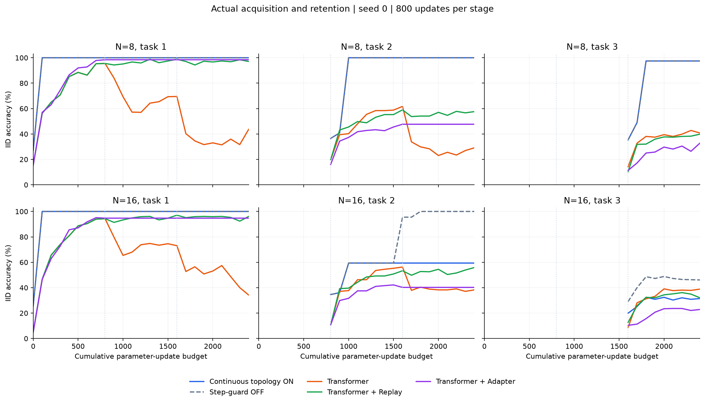
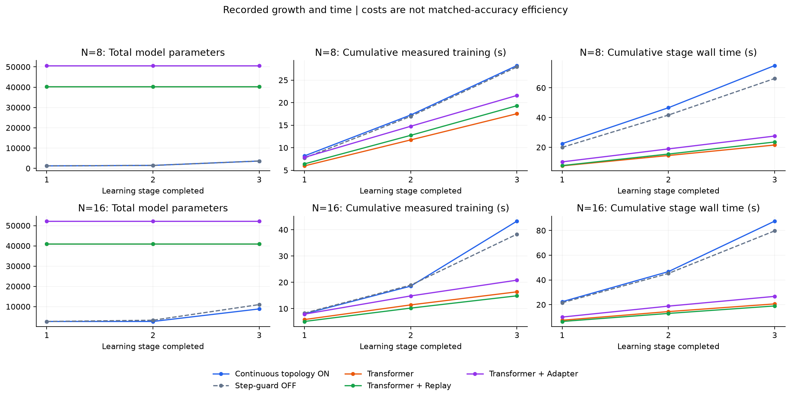

# Prometheus V2 · 连续 monodromy 主架构实验完整结果

**本批已完成；M0 未通过。** 连续 monodromy 已从第一阶段接入真实神经模型、共享参数、原语调用和三阶段持续学习。8状态获取/保持较好；16状态出现明显原语形成失败，保护开启版本第三阶段获取低于本次 Transformer，完整运行时间也更高。没有建立重要且可复现的拓扑保护优势。

记录时间：2026-11-01T16:37:22-05:00（America/Toronto）。同一 V2，MAIN=TOPOLOGY 人类锁定，M3 最终目标不变。这是一份已完成批次的证据快照，不宣布整个 campaign 完成，不覆盖旧结果，不安排会话结束后的后台训练。唯一当前方法仍为 [water/method.md](../../../../water/method.md)。

## 1. 实际跑了哪些内容

- 新主版本 continuous-native-v7：N=8、16，各有 ON/OFF 两臂，均从stage0连续训练三阶段，各阶段800次更新，batch64，seed0。全部执行退出0。
- N16：真实 Transformer、同 backbone 的 Replay、Adapter 三阶段基线，全部新执行退出0。
- N8：复用已完成的较强 LR=.003 Transformer/Replay/Adapter 结果，没有重训旧基线；实际15份数据数组和三阶段批次索引已核对一致。Native LR=.01；基线 LR=.003，均保留此前开发调优成本。
- 完成真实保存状态的推理时延测试48组：batch1/64、长度7/12/16、多种明确区分的执行接口。
- 保存源码、逐点评估/损失、数据、拒绝/回溯、真实模型/优化器checkpoint、连续执行资源及哈希收据。
- 本批没有N32、seed1/2、多随机种子统计复现，也没有N16 program-v2结果。

任务流只提供初始操作数、符号串、公开task ID和终端输出。阶段1学习加一/bit rotation/identity，阶段2引入XOR与affine操作，阶段3引入会改变后续操作解释的隐藏记忆控制符。中间状态、隐藏模式、正确操作表及调用关系不交给学习器。各阶段4096训练、512验证/IID/OOD/长度16样本，训练串长上限3/5/7，OOD为8–12。

**评估边界：** IID是独立抽样，但有限任务上存在与训练集重复的输入。N8三阶段重复分别512/291/156条（每组512）；N16为499/238/122。不能将全部IID分数称为未见组合泛化。长串OOD与长度16结果单独列出。Replay总batch仍64，后续阶段32当前+32旧样本，其当前样本数量不同，但总更新预算一致。

## 2. 连续拓扑现在实际做什么

现有软神经计算从终端CE学习操作与调用；形成事件将自身学得的完整行为安装为原生原语。对每个学得的置换，构造配置回路，并**实际跟踪无标签配置的路径提升**获得执行映射，然后已学编码、调用及读出使用这些映射。缓存只在维数、全部原语类、共享参数完全相同时复用。

四个共享路径参数从第一阶段进入同一模型和Adam，默认零初始化。对所有操作使用同一端点固定的非线性剪切：

$$
\Phi_{\omega,t}(x+iy)=x+i\left[y+\sin^2(\pi t/T)\sum_\ell\omega_\ell\tanh(v_\ell x+b_\ell)\right].
$$

固定D内，它对每个有限参数值都是全局微分同胚；参数连续变化给出固定端点、碰撞自由同伦，故每个旧操作的monodromy保持。旧输入编码/调用/读出还按已有有限关系检查，几何保护与绑定合同分工明确。

终端CE更新表示/操作/调用；数值kinetic action更新共享路径形状。当前没有假造穿过局部常值monodromy的梯度。软件使用置换商语义，不是纯编织敏感的完整量子架构；几何工作量不是测得的硬件能耗。

**OFF的准确含义：** 关闭逐步和温度guard，仍保留连续几何层、原语形成与扩容事务的旧语义检查。它不是移除了全部拓扑保护的消融。

## 3. 完整三阶段准确率

下面阶段1/2/3均使用人类顺序；原始代码stage0/1/2与之对应。新任务列是该阶段结束时的native/IID准确率；旧任务列是第三阶段结束后的实际准确率。

### 8状态

| 方法 | 第一阶段新任务 | 第二阶段新任务 | 第三阶段新任务 | 最后旧任务1 / 2 | 新任务 OOD / 长度16 |
|---|---:|---:|---:|---|---|
| Prometheus 连续拓扑 ON | 100.00% | 100.00% | 97.46% | 100.00% / 100.00% | 90.62% / 83.59% |
| Prometheus 逐步 guard OFF | 100.00% | 100.00% | 97.46% | 100.00% / 100.00% | 90.62% / 83.59% |
| Transformer | 95.51% | 61.72% | 40.82% | 43.75% / 29.10% | 11.52% / 13.48% |
| Transformer + Replay | 95.51% | 58.98% | 39.84% | 97.07% / 57.62% | 11.52% / 12.30% |
| Transformer + Adapter | 98.44% | 47.66% | 32.81% | 98.44% / 47.66% | 14.45% / 10.94% |

N8 ordinary program-v2：阶段1/2获取均100%，第三阶段51.56%，旧任务均100%；这是已有有限程序学习对照，不取代Transformer主基线。

### 16状态

| 方法 | 第一阶段新任务 | 第二阶段新任务 | 第三阶段新任务 | 最后旧任务1 / 2 | 新任务 OOD / 长度16 |
|---|---:|---:|---:|---|---|
| Prometheus 连续拓扑 ON | 100.00% | 59.38% | 31.45% | 100.00% / 59.38% | 11.33% / 7.23% |
| Prometheus 逐步 guard OFF | 100.00% | 95.51% | 46.09% | 100.00% / 100.00% | 25.39% / 15.82% |
| Transformer | 94.34% | 56.25% | 38.87% | 34.18% / 38.28% | 7.23% / 6.05% |
| Transformer + Replay | 94.34% | 53.32% | 32.03% | 96.09% / 55.86% | 8.20% / 6.05% |
| Transformer + Adapter | 94.73% | 40.23% | 22.85% | 94.73% / 40.23% | 6.05% / 6.25% |

N16 ON第三阶段soft IID为40.04%，native/连续执行31.45%；OFF分别50.98%与46.09%。这里不仅有保持问题，还有软计算到原生操作的转换问题。ON第一项旧任务被正式接纳并保护；第二项任务未达到准入要求，保留59.38%只是观察分数，不能称为已保护全部旧能力。

## 4. 修订实验与真实 checkpoint 的准确区分

此前较早N8 checkpoint已经完成：15个终端见证驱动候选→找到一个消除状态别名的原语修订→实际安装神经权重→200次额外CE训练。其后又接入连续层、额外训练200次，真实保存/重载，所有已测划分均100%。该结果有效，但包含独立计费的搜索及400次额外更新，不填入本批800步主表。

本批v7 N8再次出现同一别名，已完成15候选保存图修订：111条训练错误→0，全部15个图执行划分100%。**更新后的v7神经安装器尚未执行**，所以当前v7真实神经主表仍为97.46%，不是100%。旧版真实checkpoint与新版保存图保持分开，原始证据不改写。

## 5. 16状态暴露的主要失败

实际第二阶段中，ON的800次梯度提案均完整接受，零回溯、零拒绝；温度检查也零拒绝。因此不能说是保护拒绝阻碍了该阶段学习。

- 新符号4最终原生调用同一专家两次，其组合退化为identity；另一个新操作已学对全部单步初始状态。
- 训练数据已有符号4的137条、符号5的160条单步终端样本，均覆盖全部16个初始状态且无标签冲突。缺失反馈不能解释这一失败。
- ON最终joint验证84.57%，没有触发95%原语形成门槛；OFF达到95.31%，触发材料化，新任务IID变为95.51%。
- 两臂形成前的CE、软准确率和路由几乎相同。离散匹配/准入敏感性是具体候选解释；浮点重构是否造成差异尚未做参数级因果对照。

这是当前操作形成/离散执行的实测瓶颈。它没有否定整个拓扑方向；也不足以将两臂差异归因于保护机制。

## 6. 时间、参数与存储

| 规模 / 方法 | 参数：阶段1→2→3 | 训练 s | 模型调用总 s | 最终优化器 B | 旧关系 / 回放 B |
|---|---|---:|---:|---:|---|
| N8 / Prometheus 连续拓扑 ON | 1220→1448→3610 | 28.233 | 80.005 | 28,912 | 1,728 / 0 |
| N8 / Prometheus 逐步 guard OFF | 1220→1448→3610 | 27.928 | 66.826 | 28,912 | 1,728 / 0 |
| N8 / Transformer | 40280→40280→40280 | 17.544 | 24.770 | 322,372 | 0 / 0 |
| N8 / Transformer + Replay | 40280→40280→40280 | 19.321 | 23.601 | 322,372 | 0 / 1,376,256 |
| N8 / Transformer + Adapter | 50664→50664→50664 | 21.599 | 30.976 | 32,624 | 0 / 0 |
| N16 / Prometheus 连续拓扑 ON | 2642→2642→8836 | 43.261 | 93.709 | 70,720 | 640 / 0 |
| N16 / Prometheus 逐步 guard OFF | 2642→3254→10984 | 38.299 | 80.956 | 87,904 | 1,536 / 0 |
| N16 / Transformer | 41056→41056→41056 | 16.389 | 23.847 | 328,580 | 0 / 0 |
| N16 / Transformer + Replay | 41056→41056→41056 | 14.876 | 18.988 | 328,580 | 0 / 1,376,256 |
| N16 / Transformer + Adapter | 52224→52224→52224 | 20.823 | 26.739 | 35,760 | 0 / 0 |

模型调用总时间包含该模型训练、评估、维护、快照与checkpoint，不含全部历史开发/失败/调参。训练时间是较窄的同步计时类别。它们不是等准确率效率前沿；参数少与训练/维护快要分别判断。

Native最终地图缓存峰值：N8为768B，N16为1536B；额外四个几何参数已计入参数总量。表中的优化器、关系/回放是数值payload字节，不含完整Python对象、CPU RSS、驱动上下文等。Adapter模块含在总参数中，N16最终活跃参数4080，N8最终3688，不把全部参数冒称可训练。

**实际增长瓶颈：** N16 ON第三阶段几何矩重建323次，累计新增63,003,648个quadrature point-strands，耗时12.959秒。整个三阶段几何矩构建13.030秒、冷提升2.512秒；同一计时已包含于训练/评估，不能再次相加。N8 ON对应总矩构建0.629秒、冷提升1.512秒。硬类反复变化使几何摘要不断失效，已成为主要维护成本。

ON逐步/温度保护时间：N8为4.369/3.117秒；N16为3.066/1.802秒。冷构造/缓存、候选搜索、重训、失败记录都保留；尚无硬件能耗或完整物理生命周期成本数据。

## 7. 真实推理延迟

同一L40S、同一输入、batch1、长度16，p50/p95毫秒：

| 接口 | p50 ms | p95 ms |
|---|---:|---:|
| Native软神经前向 | 4.895 | 5.034 |
| Transformer神经前向 | 0.672 | 0.892 |
| Replay神经前向 | 0.666 | 0.682 |
| Adapter神经前向 | 1.327 | 1.358 |
| 完整连续原语库冷提升+调用 | 96.785 | 98.329 |
| 缓存实际提升映射后的CPU调用 | 0.112 | 0.121 |

神经接口5次热身+30次计时；完整连续冷提升1次热身+5次计时。缓存接口依赖已支付的库构造与CPU输入驻留，不能拿它与完整Transformer前向直接宣称神经加速。推理微基准使用较早已完成step1200连续融合checkpoint；其结构与新v7同类，但训练轨迹不同，不冒称在新v7权重上重新测过。完整48组数据及输入/模型哈希见下方证据。

同信息路径成本重建还显示：此前从人为非零剪切初始化得到的1.236%工作下降，主要是撤去初始形变。零剪切action14591.418，已学最终14591.398；普通一次完整4×4二次优化可到14590.150。解析参数没有再执行新轨迹，这不是总代价最优证明，也不是范式优势。

## 8. M0逐项判断与独立监督

| 标准 | 当前判断 |
|---|---|
| A 新能力获取 | N8已有实际形成/复用证据；N16后续阶段未掌握。部分成立。 |
| B 旧能力保持 | 已准入旧语义在检查范围保持；未准入任务不能据相同分数认领保护。部分成立。 |
| C 竞争优势 | N8准确率/参数对比有利，但更慢；N16 ON新任务低于Transformer。尚未建立重要可复现优势。 |
| D 扩展证据 | 两个规模，只有seed0；N16能力下降、维护成本增加。未通过。 |
| E 拓扑因果贡献 | 连续执行与同伦保持成立；对获取/完整成本优势的因果贡献尚未隔离。未通过。 |

独立[review032](../../supervision/reviews/review-032-primary-v7-results.md)读取实际源码、曲线和数据，独立重放864项图准确率，核对75项已准入旧关系，以及数据与批次哈希。结论M0未通过，继续拓扑MAIN的建设性发展；没有把代理一致当作科学证明。

当前最小技术问题是：让终端经验可靠形成新的原生操作，同时使拓扑保护真正降低获取—保持的代价，而不只保护已编译操作的几何形状。下一次机制修订应针对已观察的形成/准入敏感性，并同时控制几何维护开销；本报告不启动新的训练。

## 9. 可复现产物与证据索引

- [机器可读完整结果](results.json)、[全部曲线CSV](curves.csv)、[阶段成本/准确率CSV](costs-and-accuracy.csv)。生成输入的12份原始summary/records哈希存于results.json。
- 新主代码及冻结版本：`../../probes/topology-architecture/versions/code-continuous-primary-v7/`；主train SHA401d57d0…，continuous model SHAaaf3aa82…。
- [冻结主实验协议](../../probes/topology-architecture/continuous-primary-protocol-v7.json)。实际GPUrunner的隔离和资源权限沿用；没有新安装/购买/权限扩张。
- [N8主实验原始记录](../../probes/topology-architecture/runs/continuous-primary-v7-n8-seed0/learn/records.jsonl)、[N16主实验原始记录](../../probes/topology-architecture/runs/continuous-primary-v7-n16-seed0/learn/records.jsonl)、[N16基线原始记录](../../probes/topology-architecture/runs/continuous-primary-v7-n16-seed0-baselines/learn/records.jsonl)。各自checkpoints目录保存真实权重、优化器与RNG。
- [N8模型checkpoint目录](../../probes/topology-architecture/runs/continuous-primary-v7-n8-seed0/learn/checkpoints/)、[N16模型checkpoint目录](../../probes/topology-architecture/runs/continuous-primary-v7-n16-seed0/learn/checkpoints/)。各阶段step100–800均有检查点。
- [数据/预算一致性核查](../../probes/topology-architecture/current-batch-baseline-comparison-20261101.json)。
- [推理微基准原始结果](../../probes/topology-architecture/runs/inference-cost-v1/measure/summary.json)、[路径直接优化重建](../../probes/topology-architecture/runs/continuous-quadratic-reconstruction-v1/analysis.json)。
- [此前真实神经修订](../../probes/topology-architecture/runs/native-neural-repair-integration-v1/learn/summary.json)、[此前真实连续融合](../../probes/topology-architecture/runs/native-continuous-integration-v1/learn/summary.json)、[本批仅执行图修订](../../probes/topology-architecture/runs/primary-v7-witness-repair-v1/repair/summary.json)。
- 审查030/031/032及同步清单保留在同一campaign。可视化只读取冻结记录，不运行模型；PNG/SVG均已视觉核查。

CLAIM：同一端到端神经架构已实际接通连续monodromy，并完成两个规模的三阶段训练与Transformer系对照。

STATUS：批次已完成；M0未通过；V2与人类锁定MAIN未结束或转移。

EVIDENCE：真实神经参数、连续提升、共享权重变化、三阶段曲线、全部基线、完整已测成本、原始失败与独立检查。

WEAKEST LINK：稳定的新操作获取及能够降低完整获取—保持成本的拓扑因果机制。

FAILED BRANCHES/VERSION BOUNDARIES：N16当前形成/离散执行失败、维护重建变贵、现有OFF并非全部拓扑移除、单种子扩展与成本优势不足；全部旧证据保留。

NEXT SINGLE DECISION：针对这一个获取—保护接口修订现行方法，并用同信息强对照检验；本次仅报告已完成结果，不把目标当成已取得成果。
